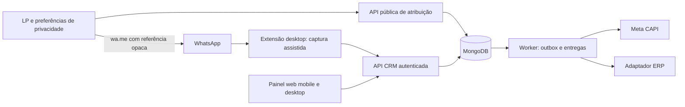

# Documento 1 — Arquitetura e Diretrizes de Desenvolvimento

Versão de revisão: 1.2 · 9 de novembro de 2026 · Base: `C:\@sites\visionsync`.

Atualização após a primeira implementação: frontend e plugin foram evoluídos e a persistência foi adaptada ao MongoDB, mantendo temporariamente Prisma 6.19 para compatibilidade dos módulos existentes. O inventário da seção 1 descreve o protótipo anterior; o restante é a especificação de destino. Consulte [estado da implementação](03-estado-da-implementacao.md) para distinguir entregue e pendente.

Decisão do usuário nesta revisão: Next.js e MongoDB são a stack de destino; TypeScript tem preferência. JavaScript é permitido quando trouxer vantagem concreta. Outras tecnologias só entram quando forem realmente necessárias, com justificativa.

Este documento substitui a proposta arquitetural fornecida na conversa de origem como **especificação proposta para a próxima implementação**. Não declara funcionalidades futuras como prontas. Nenhum código foi alterado nesta revisão. As decisões propostas devem orientar a implementação quando ela for solicitada.

## 1. Evidências e limites da análise

Foram recuperados os dois documentos originais da conversa `6af1e9b3-0b9c-83e8-9190-cb3bc3091341` e consultado o Agent Operating Guide 0.0.6. A análise foi estática: arquivos de configuração, schema, rotas, bibliotecas e scripts da extensão. Não foram executados aplicação, migrations, build ou testes; não houve acesso ao banco, ERP, conta Meta ou WhatsApp real. As afirmações do README sobre testes simulados são histórico declarado pelo projeto, não testes reproduzidos nesta revisão.

### 1.1 Inventário confirmado no código

| Área | Estado observado | Evidência relativa à raiz do protótipo |
|---|---|---|
| Aplicação | Next.js 16.2.6, React 19.2.4, TypeScript; App Router | `server/package.json`, `server/src/app/` |
| Persistência | PostgreSQL, Prisma 7.8 e adaptador pg; Supabase é citado no README, não confirmado como ambiente ativo | `server/prisma/schema.prisma`, `server/src/lib/prisma.ts` |
| UI e estado | CSS próprio e estado local; Tailwind e Zustand não constam nas dependências | `server/package.json`, `server/src/app/globals.css`, componentes |
| Autenticação | NextAuth 5 beta no painel; token Bearer por usuário na extensão | `server/src/lib/auth.ts`, `crm-auth.ts` |
| Extensão | MV3 0.16.1; JavaScript sem React; painel no DOM, service worker e ponte MAIN | `extension/manifest.json`, `content.js`, `background.js`, `page-bridge.js` |
| CRM | Contatos, listas/etiquetas, notas, compras, cobranças, lembretes, respostas rápidas e arquivos | schema e rotas `/api/crm/*` |
| Funil | Colunas são listas; contato pode aparecer em várias; mover muda associação, não cria venda | `server/src/lib/funnel.ts`, `app/api/crm/funnel/move/route.ts` |
| CAPI | Compra enviada após resposta via `after`; reenvio manual; Purchase/Recompra conforme configuração | `server/src/lib/meta.ts`, `app/api/crm/purchase/route.ts` |
| Multi-pixel | Escolhe primeira lista ordenada com pixel; senão padrão; seleção é recalculada no envio | `server/src/lib/meta.ts` |
| Atribuição | Campo opcional `ctwaClid` em Purchase; inspeção de metadados internos do WhatsApp na ponte | schema, `extension/page-bridge.js` |
| Ausências | Não identificados LP/referral persistido, `_fbp`/`_fbc`, Deal, ERP, fila durável, manifest/service worker de PWA ou WebSocket | arquivos e buscas no código |

O README tem trechos incompatíveis entre si: afirma que atalhos/respostas na extensão ainda não existem e depois descreve sua implementação. `content.js` contém barra, atalhos e ações. O código prevalece para existência; funcionamento real ainda exige homologação. A nomenclatura também mistura Vision CRM, tarot-crm e NexuSync: manter `visionsync` como identificação técnica até decisão de marca.

### 1.2 Lacunas prioritárias

1. `findContactByPhone` compara últimos oito dígitos; pessoas de DDDs/países diferentes podem ser unidas. O índice `(userId, phone)` não é único.
2. Compra manual cria um novo registro em cada POST; o ID da compra ajuda no reenvio à Meta, mas não impede duplicação na entrada. A baixa de cobrança já tem proteção transacional PENDING→PAID e vínculo único com Purchase; preservar essa proteção.
3. `Float` para dinheiro; ausência de moeda por compra e de estados de pagamento/estorno próprios.
4. CAPI tem destino/nome recalculados: mudar listas ou modo de recompra pode alterar um reenvio. Não há snapshot imutável nem fila com claim/lease.
5. API token em texto no banco e no armazenamento local da extensão; sem modelo de expiração/escopo por instalação no schema.
6. Permissão `https://*.vercel.app/*` ampla; bridge por eventos DOM e módulos internos do WhatsApp são fronteiras não confiáveis.
7. Cliente pg usa `ssl: { rejectUnauthorized: false }`; exigir validação de certificado no ambiente de produção.
8. Kanban lê até 2.000 contatos e 100 cards por coluna; cobrança lê até 500 registros. Totais dessas telas podem ser parciais: não usá-los como fechamento financeiro.

## 2. Decisões de arquitetura propostas

### 2.1 Evoluir a base existente

Adotar **Next.js (App Router) + TypeScript + MongoDB** como stack de destino. PostgreSQL/Prisma descrevem somente o protótipo atual e serão substituídos na camada de persistência. Reaproveitar UI, regras de negócio, contratos e autenticação compatíveis, adaptando os acessos ao banco. A migração faz parte do trabalho futuro; não foi executada nesta revisão.

TypeScript é o padrão para código novo e alterações substanciais, incluindo extensão e integrações. JavaScript é permitido quando houver benefício concreto de compatibilidade, simplicidade ou ferramentas, documentado no módulo. Os arquivos JavaScript distribuídos pela extensão podem ser gerados a partir de TypeScript; isso não exige React. Preservar JavaScript legado enquanto sua conversão não trouxer benefício proporcional.

O alvo é o driver oficial MongoDB para Node.js, com tipos TypeScript, repositórios por domínio e validação Zod já existente. A primeira implementação conserva Prisma 6.19 com conector MongoDB para preservar os módulos e suas consultas tipadas; substituição pelo driver direto e revisão do suporte dessa versão permanecem pendentes antes da liberação de produção. Não adicionar Mongoose ou outra camada sem necessidade comprovada. Tipagem não substitui validação em execução. [Suporte TypeScript do driver](https://www.mongodb.com/docs/drivers/node/current/typescript/).

Preferir recursos nativos da stack e dependências já úteis. Novas linguagens, bancos, frameworks, serviços ou bibliotecas precisam de necessidade concreta, alternativas avaliadas e justificativa de manutenção/custo. Tailwind, Zustand, Redis, broker externo e outros componentes não são requisitos presumidos. O worker pode compartilhar código e runtime Node.js/TypeScript com o Next.js; sua execução durável depende da hospedagem, sem impor outro serviço antes dessa decisão.

Adotar monólito modular: identidade/autorização, contatos, oportunidades, financeiro, atribuição, integrações e auditoria. Componentes de UI e rotas devem chamar serviços de domínio; regras comerciais não ficam nos seletores do WhatsApp. Usar REST inicialmente. Atualizar telas ao confirmar operações e ao recuperar foco; se necessário, polling configurável. Não prometer sincronização em tempo real nem manter WebSocket como dependência do MVP.

O MongoDB será a fonte de verdade após a migração. Extensão e painel são clientes; a LP envia somente dados permitidos a um endpoint público limitado. Meta e ERP são destinos independentes de processamento assíncrono. Falha de integração não desfaz venda já confirmada no CRM.

### 2.2 Fronteira de conta

No MVP, `userId` continua sendo a conta isolada. Toda consulta, relação, idempotência e entrega inclui esse escopo, derivado da autenticação, nunca aceito como autoridade no corpo. Validar pertencimento de contato, oportunidade, lista, pixel e integração. Testar requisições cruzadas inclusive em mídia, importação e exportação.

O protótipo não representa equipe com papéis: não chamar seu modelo atual de workspace compartilhado. `Workspace`, `Membership` e RBAC entram em fase posterior, com migração explícita. Se a primeira operação exigir vários vendedores compartilhando carteira, antecipar essa fase antes do piloto.

## 3. Modelo de dados de destino

Preservar IDs CUID existentes, usando strings em `_id` e nas referências das coleções para evitar reidentificar histórico. O `id` exposto pelas APIs continua string. UUID ou ObjectId não são requisitos para recompra: identidade única e persistida por transação é suficiente.

Todos os instantes usam UTC; exibição em `America/Sao_Paulo` no piloto. Datas civis, como vencimento e nascimento, devem ter semântica de data, preservando a convenção existente durante a migração. Não converter datas históricas implicitamente.

| Entidade | Campos/regras propostos | Restrições essenciais |
|---|---|---|
| Contact | atuais + `phoneE164`, `phoneCountry`, `identityStatus`, `deletedAt?` | único `(userId, phoneE164)` após saneamento; sem união automática por sufixo |
| Deal | `id,userId,contactId,pipelineId,stageId,status,expectedAmountMinor?,currency,openedAt,qualifiedAt?,closedAt?,version,attributionTouchId?` | status OPEN/WON/LOST; stage e pipeline da mesma conta; optimistic locking |
| Pipeline / Stage | nome, ordem; stage com chave estável NEW/CONTACTED/QUALIFIED/PROPOSAL/WON/LOST | nome visível não determina evento; uma etapa por Deal |
| StageHistory | `dealId,fromStageId,toStageId,actorId,occurredAt,reason?,version` | inserido na mesma transação da transição |
| Purchase | atuais + `dealId?,amountMinor,currency,status,confirmedAt?,externalOrderId?,attributionTouchId?` | status CONFIRMED/CANCELED/REFUNDED; moeda ISO; inteiro de centavos; chave externa por integração |
| Charge | preservar cobrança separada e vínculo único com compra; migrar valor para centavos | baixa única e atômica; cobrança não é oportunidade |
| AttributionTouch | `id,userId,publicSourceId,refHash,createdAt,expiresAt,landingPath,utm*,fbp?,fbc?,consentId?,matchedContactId?,matchedAt?,status` | refHash único; estados PENDING/MATCHED/EXPIRED/CONFLICT; valor da referência não autoriza acesso |
| ConsentRecord | `id,userId,subjectKey,purpose,status,policyVersion,occurredAt,source,withdrawnAt?` | trilha de finalidade e revogação; coleta mínima de evidência |
| DomainEvent | `id,userId,type,aggregateId,aggregateVersion,occurredAt,payloadVersion,minimalPayload` | único `(userId,type,aggregateId,aggregateVersion)` |
| IntegrationDelivery | `id,userId,domainEventId,destinationId,externalEventName?,externalEventId?,payloadSnapshot,status,attempts,nextAttemptAt,leaseUntil?,lastCode?,lastError?,deliveredAt?` | único evento+destino+versão de mapeamento; payload protegido e mínimo |
| IdempotencyRecord | `userId,operation,key,requestHash,responseStatus,responseBody,createdAt` | único conta+operação+key; mesma chave com corpo diferente retorna 409 |
| ErpIntegration / ExternalMapping | endpoint permitido, credencial cifrada, contrato/versão; vínculo entidade↔ID externo | único integração+tipo+ID externo; endpoint não vem de chamada pública |
| ExtensionCredential | token hash, prefixo, conta, instalação, escopos, expiração, revogação | segredo mostrado uma vez; nunca trafega pela ponte MAIN |
| AuditLog | ator, ação, entidade, instante, campos alterados sem segredos | acesso restrito; retenção definida |

`CrmList`/`CrmListMember` permanecem etiquetas múltiplas. Não convertê-las silenciosamente em etapas exclusivas. `Note`, `Reminder`, `QuickReply` e arquivos continuam disponíveis; revisar retenção e dados sensíveis, sem apagar conteúdo na migração.

Deal representa tentativa comercial; Purchase representa transação confirmada. Um contato pode ter vários Deals e várias compras. Um Deal pode ter várias compras se o negócio exigir pagamentos separados; cada compra precisa de identidade comercial própria. Para o piloto simples, uma compra confirmada pode encerrar o Deal; parcelas devem ser especificadas antes de liberar esse caso para evitar contar cada parcela como pedido novo.

### 3.1 Persistência e integridade no MongoDB

Mapear entidades da tabela para coleções, mantendo compras, histórico, entregas, notas e arquivos separados de Contact para evitar arrays de crescimento ilimitado. Referências são IDs explícitos; MongoDB não aplica as foreign keys/cascatas do schema Prisma. Serviços precisam validar existência e conta de origem e implementar exclusão/anonimização conforme política, com verificação de referências órfãs.

Criar índices compostos únicos para as chaves de negócio da tabela antes de liberar escrita. Campos opcionais, como externalOrderId e purchaseId de cobrança, exigem índices únicos parciais aplicáveis apenas a valores presentes e válidos. Não confiar só em consulta prévia para impedir duplicatas. [Índices únicos MongoDB](https://www.mongodb.com/docs/manual/core/index-unique/).

Usar operações condicionais atômicas para versão do Deal, baixa da cobrança e claim/lease de entrega. Quando uma operação alterar várias coleções — compra, cobrança, evento e outbox, por exemplo — usar a mesma sessão/transação, sem chamadas externas dentro dela. O ambiente de desenvolvimento, teste e produção precisa de replica set ou cluster compatível com essas transações; instância standalone não atende este desenho. Tratar retries de transação sem efeitos externos no callback. [Transações MongoDB](https://www.mongodb.com/docs/manual/core/transactions/).

Aplicar validação de entrada e validadores de coleção para campos críticos; versionar scripts de criação de índices e evolução de documentos. Valores monetários continuam inteiros em centavos, limitados à faixa de inteiros seguros na aplicação, com moeda explícita. TTL pode auxiliar limpeza quando aplicável, mas não determina validade: referências expiradas devem ser recusadas por expiresAt mesmo antes da remoção física.

### 3.2 Migração PostgreSQL/Prisma → MongoDB sem perda

1. Fazer backup e ensaiar restauração em ambiente isolado; inventariar contagens, valores e relacionamentos.
2. Criar coleções/validadores/índices no MongoDB sem remover a origem. Exportar de forma controlada todas as entidades e arquivos, preservando IDs, datas, hashes de senha e segredos cifrados com suas chaves compatíveis. Gerar relatório de telefones inválidos e colisões; revisão humana antes de unir, preservando notas, cobranças e compras.
3. Preencher centavos com regra de arredondamento explícita, comparar somatórios por conta e amostras. Casos ambíguos ficam em relatório, sem ajuste silencioso.
4. Manter compras históricas e IDs/eventos já enviados. **Não reenviar histórico** em razão da migração e não reclassificar compras como novos Leads.
5. Ativar novos comandos atrás de configuração por conta; criar Deals históricos somente com regra aprovada e origem `migration`, sem eventos externos.
6. Ensaiar corte com janela de suspensão de escrita, carga final e reconciliação de contagens, valores, arquivos e referências por conta. Trocar aplicação e worker juntos para evitar duas fontes ativas e entregas duplicadas. Manter PostgreSQL de origem preservado até encerrar a validação.
7. Conferir integridade; remover dependências Prisma/pg apenas após todos os acessos terem sido substituídos. Antes de reabrir escrita, rollback pode retornar à origem. Depois de novas escritas no MongoDB, retorno exige reconciliar/exportar essas alterações; nunca apontar simplesmente para uma cópia antiga. Conservar compras e entregas já aceitas em qualquer recuperação.

## 4. Fluxo LP → WhatsApp → CRM

### 4.1 Entrada e referência

1. A LP mostra informação de privacidade e opções de marketing. Para o piloto, adotar consentimento específico como decisão de produto para cookies/compartilhamento publicitário; atendimento continua disponível após recusa. Outra base legal exige avaliação documentada, não simples alteração no banner.
2. Com permissão vigente, obter `_fbp` e `_fbc` reais quando presentes. `_fbc` é o cookie de clique, distinto de `fbclid`; só derivar `fbc` de `fbclid` efetivamente recebido segundo formato oficial validado. Não inventar identificadores. Não coletar texto livre da URL nem parâmetros com dados pessoais.
3. `POST /api/public/attribution-touches` recebe origem pública cadastrada, consentimento, UTMs permitidas e cookies elegíveis. Origem pública vincula servidor à conta e destino WhatsApp; não fornece acesso ao CRM.
4. Servidor cria referência aleatória com pelo menos 128 bits de entropia, codificada em formato seguro de URL, guarda seu hash e retorna `ref`, `expiresAt` e link `wa.me` com mensagem codificada. Exemplo: `Olá, quero saber mais! [Ref: <token-opaco>]`. Não usar códigos sequenciais como L-982.
5. Referência válida por sete dias no piloto (prazo de conciliação proposto, diferente da janela de atribuição da Meta). Guardar tokens apenas enquanto necessários; limpar/reduzir dados conforme política.
6. Após recusa, oferecer link direto ao WhatsApp sem cookies nem referência de marketing. Falha do endpoint não bloqueia atendimento; mostrar link alternativo e registrar apenas métrica operacional permitida.

Endpoint público: HTTPS, limite de tamanho, validação de origem cadastrada, quota por origem/IP, prevenção de replay e abuso; CORS é defesa auxiliar, não autenticação. Não expor se uma referência existe a usuários anônimos. Não incluir telefone/e-mail/cookies no token ou em mensagens de erro.

### 4.2 Conciliação assistida

1. Usuário envia a mensagem; clicar no link não comprova envio ou recebimento.
2. Extensão identifica conversa individual e referência em mensagem recebida. Nome, DOM e identificador interno não bastam para provar telefone; LID não é telefone E.164.
3. Exibir contato/telefone/ref detectados; no piloto, exigir confirmação do vendedor antes de vincular. Se telefone não for confiável, entrada manual validada, sem atribuição automática.
4. `POST /api/crm/attribution-matches` autenticado recebe `ref,contactId,observedAt,evidenceKind` e chave de idempotência. Backend verifica conta da origem, validade, contato, finalidade e conflito.
5. Na mesma transação: marcar touch, vincular contato/Deal e gerar evento de domínio elegível. Não enviar corpo de conversa ao CRM/Meta; persistir apenas evidência mínima.
6. Mesmo token+mesmo contato retorna resultado anterior; token+outro contato retorna 409 e revisão. Token expirado, ausente ou removido mantém atendimento como origem não conciliada. Não inferir identidade por horário, nome ou sufixo de telefone.

Referência pode ser encaminhada ou copiada: é indício de origem, não autenticação da pessoa. Guardar todas as interações elegíveis; regra do piloto: último touch conciliado anterior à abertura do Deal dentro de sete dias. Fixar esse touch no Deal e copiar para a compra; nova recompra não herda automaticamente um clique antigo. Diferenciar `attributionStatus=matched/unmatched/manual/conflict` e apresentar cobertura, sem chamar toda compra de atribuída.

### 4.3 Caminhos distintos

- LP→WA usa referência e cookies da LP. Anúncio direto para WhatsApp pode possuir `ctwa_clid`; isso não é `_fbc`, não deve ser fabricado nem intercambiado. O código atual tenta inspecionar metadados internos; não considerar esse caminho suportado sem validação do produto/API oficial aplicável.
- Uso apenas no celular não executa a extensão desktop: vendedor registra contato e referência no painel. Exibir data da última sincronização; não prometer leitura automática do app móvel.
- Fechar WhatsApp/Chrome interrompe observação, mas não pode interromper entregas já persistidas no backend.

## 5. Oportunidade, venda e eventos

### 5.1 Regra comercial

Mover etiqueta nunca cria receita. No novo funil de Deals, transição para WON exige confirmação com valor, moeda e data e uma das ações explícitas: registrar compra já paga, vincular compra existente ou criar cobrança pendente. Criar cobrança não dispara Purchase. Proposta do piloto: Purchase representa compra com pagamento confirmado; WON sem pagamento não é compra confirmada.

A baixa manual ou webhook autenticado de pagamento confirma Purchase uma vez. Reabrir Deal não repete Lead/qualificação/compra. Estorno altera financeiro e auditoria, sem criar Purchase negativo nem apagar envio anterior; sinal externo de reembolso só após definir contrato aceito pelo destino.

### 5.2 Catálogo e nomenclatura

| Evento interno | Gatilho único | Mapeamento Meta proposto | ID estável |
|---|---|---|---|
| `lead.created.v1` | novo Deal com contato válido, origem/autor registrados e finalidade elegível | `Lead` | `lead:<dealId>` |
| `lead.qualified.v1` | primeira qualificação do Deal com critérios preenchidos | `CRMQualifiedLead` **customizado** no piloto | `qualified:<dealId>` |
| `purchase.confirmed.v1` | compra confirmada com valor positivo/moeda | `Purchase`, incluindo recompras | preservar ID atual para histórico; novas: `purchase:<purchaseId>` |
| `purchase.refunded.v1` | estorno confirmado | nenhum envio Meta no MVP | `refund:<refundId>` |
| `deal.stage_changed.v1` | mudança válida de etapa com versão | nenhum por padrão | evento interno persistido |

Qualificação do piloto: intenção de compra confirmada, produto/interesse definido e próximo passo registrado. Guardar quem e quando qualificou. `Qualified` do documento original não é assumido como evento padrão. Avaliar `QualifiedLead` no produto de integração escolhido em homologação; não trocar nomes sem versionar mapeamento. Evento customizado pode exigir conversão personalizada e não assegura otimização disponível.

Clique na LP pode ser telemetria de clique elegível, mas não é `Lead` neste contrato. Evitar disparar um Lead no clique e outro diferente na conversa para a mesma etapa. Se houver cópia browser de um mesmo evento, backend deve entregar ao browser o ID canônico; não tentar deduplicar fatos diferentes. Mapeamento de recompra padrão passa a ser Purchase; preservar histórico `Recompra` sem reenviar ou renomear eventos já entregues.

### 5.3 Três níveis de deduplicação

1. **Comando CRM:** extensão/painel gera `Idempotency-Key` ao iniciar ação e reutiliza em timeout/retry; banco retorna compra original. Nova compra legítima recebe chave nova. Double-click, reconexão e importação não podem criar duas vendas.
2. **Entrega interna:** evento e outbox criados atomicamente; restrição única por evento/destino; concorrência controlada com lease. Timeout após aceite externo resulta em reenvio da mesma identidade, nunca nova compra.
3. **Meta:** mesma conversão enviada por Pixel e CAPI precisa mesmo `event_name`, `eventID`/`event_id` e mesmo dataset. Reenvios conservam destino, nome, hora, valor e ID. Nova recompra tem outro Purchase ID. Não depender da janela externa de deduplicação para integridade financeira interna.

## 6. Motor CAPI e outbox

### 6.1 Payload e identidade

Enviar `event_name,event_time,event_id,action_source,user_data` e `custom_data` conforme contrato homologado. `event_time` é o instante do fato, não do retry. Valor em centavos é convertido para unidade monetária apenas no adaptador; incluir `currency`. Não enviar nome do produto se revelar dado sensível.

Normalizar e aplicar SHA-256 apenas aos campos que exigem hash, como telefone/e-mail e external_id. Hash é pseudonimização, não anonimização nem criptografia reversível. `_fbp/_fbc` devem ir como `fbp/fbc` sem hash quando elegíveis; não aplicar SHA indiscriminadamente. E-mail existe em Contact, mas o builder atual não o inclui. Não presumir país BR quando o telefone indicar outro país.

Não enviar IP/user agent do vendedor ou do servidor como se fossem do lead. Usar dados da interação original apenas se necessários, autorizados e compatíveis. Não enviar notas, nascimento, texto de conversa ou diagnósticos internos. `ctwa_clid` somente no contrato oficialmente suportado.

O código atual usa `action_source=chat` e Graph `v27.0`. Isso é configuração observada, **não homologação de versão nem de atribuição para o novo fluxo**. Manter uma matriz por tipo de evento/origem; validar `chat` versus `website` e event_source_url com documentação e Events Manager antes de produção. Não declarar `business_messaging` compatível apenas por usar WhatsApp Web.

### 6.2 Operação durável

Na transação da compra/qualificação, inserir DomainEvent e IntegrationDelivery. Worker separado, disparado por infraestrutura do backend, busca pendentes com lock/lease. `after()` pode acelerar uma tentativa, mas não substitui fila persistida. A implementação futura desse worker é parte do produto, não autorização para criar uma rotina pessoal nesta conversa.

Estados: PENDING→PROCESSING→DELIVERED; falha transitória→RETRY; configuração/dado inválido→BLOCKED; limite de tentativas→DEAD; prazo do provedor excedido→EXPIRED; finalidade revogada→SUPPRESSED. Retentar rede/timeout/429/5xx com jitter, respeitando Retry-After; proposta: 1 min, 5 min, 15 min, 1 h, 3 h, 6 h e depois 6 h, até 12 tentativas ou prazo elegível. Não atualizar event_time para contornar expiração.

Persistir snapshot mínimo do payload, dataset e nome na criação da entrega. Mudança de listas não muda entrega pendente. Reprocessar exige mesma identidade; mudança deliberada de destino é ação auditada, não retry. Congelar ordenação de recompra por `(confirmedAt,id)`; não renumerar payload histórico por importação tardia.

Registrar código, erro sanitizado, trace ID quando disponível, latência e tentativas. Resposta de aceite não comprova atribuição, correspondência, faturamento nem ROAS. Remover tokens de URLs/logs; credenciais somente no backend. Usar dataset separado de homologação: não tratar `test_event_code` como isolamento garantido.

O protótipo bloqueia compras após aproximadamente sete dias (com uma hora de margem). Confirmar janela e requisitos do endpoint efetivamente contratado antes de liberar. Exibir expirados ao operador, sem tentar revivê-los. Painel mostra integração pendente/falha separada da venda registrada.

## 7. Contratos REST propostos

Estes endpoints novos não existem ainda. Preservar rotas atuais durante transição e fazer ambas chamarem os mesmos serviços.

| Endpoint | Entrada principal | Resultado e regra |
|---|---|---|
| `POST /api/public/attribution-touches` | origem cadastrada, preferências e dados permitidos | 201 ref/expiração/link; 429 abuso; sem acesso a contatos |
| `POST /api/crm/attribution-matches` | ref,contactId,observedAt,evidenceKind | 200/201 vínculo; 409 conflito; idempotente |
| `POST /api/crm/deals` | contactId,pipelineId,interesse,próximo passo | 201 Deal e evento; mesma chave retorna recurso original |
| `PATCH /api/crm/deals/:id/stage` | stageId,expectedVersion,reason? | 200 nova versão; 409 concorrência; histórico transacional |
| `POST /api/crm/deals/:id/close` | expectedVersion,outcome,paymentAction,valor/moeda/data | transação única; valida ação financeira; sem Purchase em cobrança pendente |
| `POST /api/crm/purchases` | contactId,dealId?,amountMinor,currency,confirmedAt,externalOrderId? | 201 compra e outbox; idempotência obrigatória |
| `GET /api/crm/integration-deliveries` | status,destino,cursor | status sem segredos/payload pessoal completo |
| `POST /api/crm/integration-deliveries/:id/retry` | motivo | 202 mesma entrega; rejeita enviada/suprimida/expirada |
| `POST /api/integrations/erp/:integrationId/webhook` | evento assinado com ID externo | 202 após inbox durável; duplicata sem efeitos adicionais |

Corpos JSON estritos com Zod; limite de tamanho, dinheiro inteiro positivo, moeda suportada, telefone validado, datas válidas e não futuras para conversões. Erros: 400 validação, 401 credencial ausente/inválida, 404 recurso indisponível na conta, 409 conflito, 429 limite. Retornar requestId e mensagem segura. APIs com sessão exigem proteção de origem/CSRF nas mutações; Bearer com escopos separados. Paginar listas e agregar totais diretamente no banco.

## 8. Integração ERP

ERP não foi identificado nem consta implementado. Criar interface de adaptador com operação `upsertConfirmedOrder`; habilitar conector real somente após confirmar fornecedor, autenticação, catálogo, cliente, tributos, unidades, regras de pedido/faturamento e ambiente de homologação.

Contrato canônico mínimo v1: `schemaVersion,eventId,eventType,occurredAt,accountExternalId,order{id,externalId?,confirmedAt,currency,totalMinor,items[]},customer{id,externalId?,name,phone?,email?}`. Cada item: referência de produto, quantidade e valor; se o ERP exigir itens, não substituir por uma descrição genérica sem regra aprovada. CPF/endereço só quando necessários e coletados com fundamento específico. O modelo atual tem produto textual, insuficiente para ERPs que exigem SKU/tributação.

1. CRM é dono de relacionamento e Deal; ERP é dono do ID externo e estados fiscais/estoque. Para o piloto, CRM registra pagamento manual e envia venda confirmada; se ERP for a fonte de pagamento, definir webhook antes de ativar baixa automática.
2. Requisição usa ID estável do pedido e chave idempotente. Persistir mapeamento antes de concluir entrega. Em timeout, consultar pedido pela chave externa antes de criar novamente.
3. Quando ERP não suporta idempotência nem consulta por ID externo, bloquear retry automático ambíguo e exigir reconciliação manual. Não prometer exatamente uma entrega na rede.
4. Webhooks usam HMAC sobre corpo bruto, timestamp, limite de desvio e deduplicação por ID de mensagem em inbox. Segredo por integração e rotação. Retornar aceite só após gravação durável; falha de validação não atualiza financeiro.
5. Evitar ciclos: registrar origem e não republicar retorno como nova venda. Estorno/cancelamento recebe operação própria; ERP indisponível não bloqueia Meta nem o CRM.
6. Tela de conciliação: pedido CRM, ID ERP, valor/moeda, estado e divergência. Reenvio auditado. Se o ERP não oferecer API, exportação manual documentada é contingência, não integração concluída.

## 9. Extensão MV3 e WhatsApp Web

A extensão oferece conveniência desktop e depende de interface não contratada. Não chamar de integração oficial nem garantir disponibilidade, gratuidade integral, aprovação ou ausência de restrição de conta. Os termos comerciais do WhatsApp precisam ser avaliados para o uso pretendido; uso de módulos internos e coleta automatizada elevam o risco. [Termos WhatsApp Business](https://www.whatsapp.com/legal/business-terms/).

| Risco observado | Requisito de implementação e contingência |
|---|---|
| `page-bridge.js` usa `window.require` e módulos internos; DOM muda | encapsular adaptador, testar contra WhatsApp real autorizado, registrar versão; falha fecha captura e oferece painel manual |
| Dados de MAIN e eventos `vcrm-req/vcrm-res` podem ser forjados pela página | validar esquema, tamanho, tipo e correlação; assumir entrada hostil; ID/nonce não tornam MAIN confiável; confirmar ações financeiras |
| Troca de conversa enquanto request está pendente | correlacionar chat/telefone e versão de seleção; descartar resposta antiga; confirmar destinatário antes de escrita |
| Número não disponível/LID/grupo/canal | bloquear captura automática; nunca converter identificador opaco em telefone |
| Worker MV3 termina e perde variáveis globais | persistir pendências necessárias, reinicializar por evento, usar API idempotente; fila principal no servidor |
| Permissões amplas/URL configurável | produção com domínio específico; validar URL, método, path e remetente no background; impedir encaminhamento arbitrário de token |
| Token local pode ser roubado; content script o lê na inicialização atual | segredo isolado no contexto de extensão, escopo mínimo/expiração/revogação; não mandar token a MAIN ou ao DOM |
| Inserção HTML e dados pessoais em diagnósticos | manter escape de texto, revisar sinks, diagnósticos redigidos e compartilhamento explícito |
| Loja MV3 e código remoto | empacotar lógica; nenhum eval/script remoto; publicar com política de privacidade e permissões justificadas |
| Extensão quebrada ou suspensa | kill switch de funcionalidade como dado, sem código remoto; backend e operação manual continuam |

Workers podem ser encerrados e código precisa tolerar reinicialização, conforme [ciclo de vida MV3](https://developer.chrome.com/docs/extensions/develop/concepts/service-workers/lifecycle). Lógica distribuída pela loja deve acompanhar o pacote, conforme [política de código remoto](https://developer.chrome.com/docs/extensions/develop/migrate/remote-hosted-code).

No MVP, mensagens e arquivos permanecem com envio humano; não incluir disparo em massa, automação de Enter, raspagem irrestrita ou tentativa de contornar bloqueios. Importação de contatos exige seleção e resumo antes da gravação. Não presumir que WhatsApp aberto representa consentimento para publicidade.

## 10. Privacidade, LGPD e segurança

Os requisitos abaixo são desenho de produto para viabilizar operação responsável; a base legal e as responsabilidades precisam ser registradas com o controlador antes de produção. A LGPD estabelece princípios, bases e direitos; hash não elimina essas obrigações. [Texto legal](https://www2.camara.leg.br/legin/fed/lei/2018/lei-13709-14-agosto-2018-787077-norma-pl.html). A interface de preferências deve permitir decisão informada, alinhada às orientações da [ANPD sobre cookies](https://www.gov.br/anpd/pt-br/centrais-de-conteudo/materiais-educativos-e-publicacoes/guia_orientativo_cookies_e_protecao_de_dados_pessoais).

- Separar finalidades: atendimento, execução da venda, obrigação fiscal, métricas e publicidade. O cliente empresarial tende a controlar dados de seus clientes; a plataforma pode atuar como operadora nesse serviço e controladora de dados próprios de conta. Formalizar responsabilidades, subprocessadores e transferências internacionais, sem presumir um único papel para tudo.
- Marketing recusado/revogado: não criar cookie publicitário nem enviar CAPI correspondente. Verificar elegibilidade na coleta **e na tentativa de envio**; suprimir fila pendente após revogação. Atendimento e obrigações legais podem seguir conforme sua própria base.
- Coletar mínimo: telefone/nome necessário, origem e compra. Nascimento e notas não são necessários ao CAPI. O protótipo vem de contexto de tarot; notas e produto podem revelar religião, saúde ou vida íntima. Proibir envio desses campos à Meta e orientar uso do CRM; avaliar operação com dados sensíveis antes de liberar.
- Proposta inicial de retenção, sujeita à política do controlador: referências pendentes por 7 dias; identificadores publicitários conciliados por até 90 dias; logs técnicos redigidos por 30 dias; auditoria por 180 dias; backups por 30 dias. Histórico financeiro segue tabela de obrigações aplicáveis, definida antes do piloto, sem prazo fiscal inventado. Execução de limpeza precisa respeitar bloqueios legais e registrar resultado.
- Disponibilizar solicitação de acesso, correção, exportação, eliminação e revogação com verificação de identidade; retirar de filas, caches e integrações quando aplicável; documentar exceções e expiração de backups. CSV atual não substitui atendimento completo de direitos.
- HTTPS, segredos cifrados no servidor, chave dedicada e versionada (a atual deriva de NEXTAUTH_SECRET), rotação e recuperação ensaiadas; token da extensão apenas hash no banco, nunca em logs.
- Rate limit em login/cadastro/API pública; revisão de CSRF, controle por conta, backups cifrados, restauração testada e resposta a incidentes com responsáveis. Não afirmar segurança auditada por existir NextAuth ou Zod.

## 11. Verificação e observabilidade

Obrigatórios antes de liberar: isolamento entre contas; colisões de telefone; dois POSTs simultâneos de compra; baixa concorrente; rollback transacional da outbox; dois workers; timeout após aceite; mudança de lista durante retry; consentimento revogado; referência encaminhada/expirada; troca de chat; indisponibilidade de WhatsApp/Meta/ERP; recuperação de backup.

Métricas: idade da fila, falhas por destino, tempo até entrega, expirados, conflitos de identidade, cobertura de conciliação, supressões por privacidade e versão da extensão. Logs com requestId/eventId e IDs internos, sem token, telefone bruto, cookie ou conversa.

Aceite de APIs externas não comprova atribuição. EMQ, elegibilidade a otimização por valor, ROAS e retorno devem ser observados em conta homologada; não são garantias contratuais.

## 12. Fontes e pendências de validação externa

Fontes primárias consultadas em 09/11/2026: Chrome lifecycle/código remoto, WhatsApp Business Terms, LGPD e ANPD, vinculadas nas seções acima. As páginas oficiais da Meta sobre [deduplicação](https://developers.facebook.com/docs/marketing-api/conversions-api/deduplicate-pixel-and-server-events) e [fbp/fbc](https://developers.facebook.com/docs/marketing-api/conversions-api/parameters/fbp-and-fbc/) responderam 429 na consulta; os contratos propostos devem ser conferidos nelas na implementação. Não foi possível homologar nesta análise versão Graph, janela temporal, suporte a eventos de qualificação ou compatibilidade de ctwa_clid com o destino usado. Esses pontos são bloqueios de produção, não motivo para alterar os fatos históricos ou fabricar campos.
